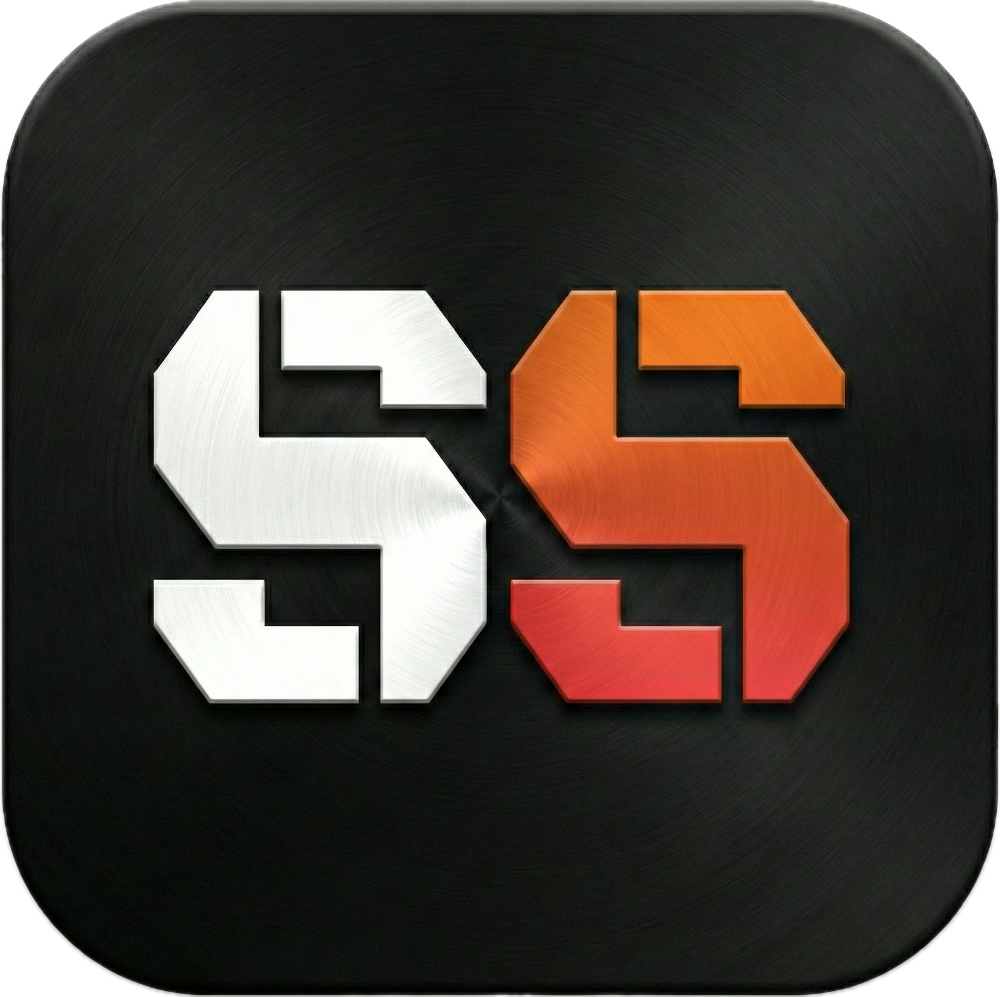

# ⚽ SQUAD SNIPER

축구/풋살 팀의 포지션을 공정하고 재미있게 배정하는 인터랙티브 웹 게임입니다.
페널티킥 슈팅 게임을 통해 선수들에게 역할을 랜덤하게 할당하는 드래프트 시스템입니다.

<div align="center">
  
</div>

## ✨ 주요 기능

- 🎯 **슈팅 게임 기반 드래프트**: 조준하고 슈팅해서 포지션 배정
- 🎮 **직관적인 조작**: WASD/방향키 조준, Shift 정밀 모드, 스페이스/Enter 슈팅
- ⏱️ **10초 타이머**: 긴장감 있는 시간 제한
- 🌐 **다국어 지원**: 한국어/English
- 🎨 **미스터리 모드**: 역할 숨김으로 공정성 보장
- 👥 **무제한 선수**: 12명 기본 + 추가 역할 지원
- 🎵 **사운드 효과**: Web Audio API 기반 실시간 음성 생성
- 📱 **반응형 디자인**: 모바일/PC 모두 지원

## 🚀 시작하기

### 필수 요구사항

- Node.js (최신 버전 권장)

### 설치 및 실행

```bash
# 의존성 설치
npm install

# 개발 서버 실행 (포트 3000)
npm run dev

# 프로덕션 빌드
npm run build

# 빌드 미리보기
npm run preview
```

## 🎮 게임 방법

### 1. 설정 단계
- 선수 이름 입력 (최소 1명, 무제한)
- 12명 초과 시 커스텀 역할 및 미션 설정 가능

### 2. 게임 플레이
- 화면에 무작위로 움직이는 유니폼이 표시됩니다
- **WASD** 또는 **방향키**로 스코프(조준선) 이동
- **Shift** 키로 정밀 조준 모드
- **스페이스** 또는 **Enter**로 슈팅
- 10초 안에 슈팅하지 않으면 자동 할당
- 마지막 선수는 자동으로 할당

### 3. 결과 확인
- 각 선수의 포지션과 미션 확인
- "다시 하기"로 새로운 드래프트 시작

## 🎯 포지션 목록

### 핵심 포지션 (12개)
- **GK** (Goalkeeper) - 골키퍼
- **RB** (Right Back) - 우측 수비수
- **RCB/LCB** (Center Backs) - 중앙 수비수
- **LB** (Left Back) - 좌측 수비수
- **CDM** (Defensive Midfielder) - 수비형 미드필더
- **LW/RW** (Wingers) - 측면 공격수
- **CM** (Center Midfielder) - 중앙 미드필더
- **ST** (Striker) - 공격수
- **CAM** (Attacking Midfielder) - 공격형 미드필더
- **MGR** (Manager) - 감독

### 추가 역할 (13개)
SUB1~3 (교체 선수), RES (예비), MED (의무), KIT (장비), VAR (심판), H2O (물), ASST (코치), SCT (스카우트), PHYS (피지컬 코치), ANL (분석가), GKC (골키퍼 코치), FAN (팬)

## 🛠 기술 스택

- **Frontend**: React 19.2.3
- **Language**: TypeScript 5.8
- **Build Tool**: Vite 6.2.0
- **Styling**: Tailwind CSS
- **Icons**: Lucide React
- **Audio**: Web Audio API

## 📁 프로젝트 구조

```
squad-sniper/
├── components/
│   ├── GameInterface.tsx    # 게임 메인 로직
│   ├── SetupScreen.tsx       # 선수 설정 화면
│   └── Jersey.tsx            # 유니폼 컴포넌트
├── utils/
│   └── audio.ts              # 사운드 효과
├── constants.ts              # 역할, 미션, 번역 정의
├── types.ts                  # TypeScript 타입 정의
├── App.tsx                   # 최상위 컴포넌트
└── index.tsx                 # 진입점
```

## 🌟 특징

- ✅ 외부 음원 파일 불필요 (Web Audio API로 실시간 생성)
- ✅ 프레임워크 의존성 최소화
- ✅ requestAnimationFrame 기반 부드러운 애니메이션
- ✅ SEO 최적화 (동적 메타 태그)
- ✅ 정확한 히트 판정 (DOM bounding rect 계산)

## 📝 라이선스

이 프로젝트는 개인/팀 사용을 위한 오픈 소스입니다.

---

**즐거운 게임 되세요! ⚽🎯**
